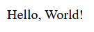
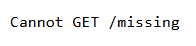

# Web Server

An Express server that serves the page in `public` and one text route.

## Description

From this folder, `npm start` runs `node server.js`. `npm run dev` runs the same file with nodemon. This run listened at http://localhost:3000.

On startup the server calls `add(1, 2)` and `substract(1, 2)` from `utils/index.js`, then prints:

```
3
-1
Server is running at http://localhost:3000
```

`substract` is spelled that way in the source. `add` returns the sum. `substract` returns the first number minus the second.

`express.static` serves the `public` folder, so `GET /` is `public/index.html`. The tab title is **My App**. The heading is "Welcome to my website!" and the image alt text is "Node.js Logo". `style.css` sets that image to 300px wide. The page does not set a font or a background. In this browser the heading is Times New Roman, 32px, black. The screenshot is on white so that heading and the dark logo stay visible.

`GET /v1` answers `200` with the body `Hello, World!`. The content type is `text/html; charset=utf-8`. The server also prints `Incoming req --> GET /v1`. The page does not set a background. This shot is on white. The text is Times New Roman at 16px.

`GET /missing` is the Express 404 page. The tab title is **Error** and the page says `Cannot GET /missing`.

## Screenshots

### Home page


### GET /v1



### A path with no route



## Getting Started

### Dependencies

* Node.js and npm

### Installing

```bash
npm install
```

### Executing program

```bash
npm start
```

This run listened at http://localhost:3000. `npm run dev` runs the same file with nodemon.

## Help

`GET /missing` is the Express page `Cannot GET /missing`. The startup log spells the subtract helper `substract`.

## Authors

[Mamadou Moussa Balde](https://www.linkedin.com/in/2mb/)

## Version History

* Current local run
    * Listened at http://localhost:3000
    * Startup printed `3`, then `-1`, then the listen line

## License

This folder does not include a `LICENSE.md` file.

## Acknowledgments

* [README template](https://gist.github.com/DomPizzie/7a5ff55ffa9081f2de27c315f5018afc)
